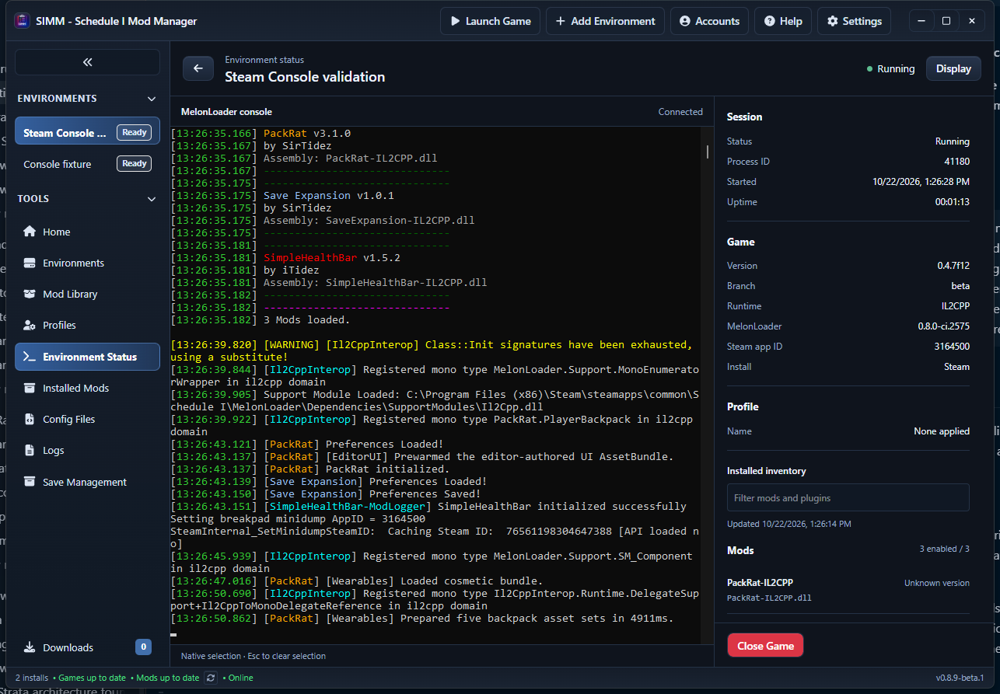

# Environment status workspace follow-up — 2026-10-22

This revises the earlier dedicated Console window after user review. Environment Status is now a view inside the main SIMM shell. The actual Windows console remains an independent, unowned native window aligned to the DOM console pane; no SetParent or game lifetime ownership is introduced.

The subsequent [installed version extraction follow-up](2026-10-22-installed-mod-versions.md) adds direct MelonInfo/assembly inspection, version provenance, and Refresh inventory to the sidebar described below.

## Interface

- Open Status on an environment card, or Environment Status in the main navigation. Automatic opening after Steam launch remains enabled by default and configurable under Settings or Display.
- The header identifies the environment and running state. The main panel retains native MelonLoader console selection. The details inspector shows process ID, start time, uptime, game/branch/runtime/loader versions, Steam app ID, installation type, and active profile name/runtime/update time when available.
- Separate Mods and Plugins lists show enabled totals, versions, authors when known, file names and disabled state. The filter matches names, authors, versions and file names. Inventory refreshes when opening the status view and includes an updated timestamp; it does not claim that installed modules were loaded.
- The inspector has a constrained, keyboard-focusable scrolling region. Close Game remains outside the scrolling content and requires an inline confirmation. Back or navigation never calls Close Game.
- Display controls use short descriptive labels. The explanatory sidebar paragraphs have been removed.

## Native visibility and recovery

The frontend reports the console pane's logical client coordinates and visibility through a typed ApiService command. Resize/mutation observers follow layout changes; a bounded periodic measurement also follows CSS transitions. Revision ordering discards stale updates. Moving to another workspace hides the native pane and clears selection. Overlapping dialogs hide it; the inline sidebar confirmation does not cover the pane. Minimizing SIMM hides it, and returning restores it to its measured rectangle.

The controller uses the main SIMM HWND and scales the pane's offset and dimensions to monitor coordinates. It never changes the console parent or owner. Shutdown and the independent recovery guard still restore the original console while leaving the game running. The feature installs no game plugin. Steam dispatch and launch arguments are unchanged.

Initial native testing exposed a transient Windows sharing error during atomic control-file replacement. Atomic writes now retry only the Windows access/sharing/lock errors for a short bounded interval; failed viewport reports are retried and their error clears on recovery. A regression test holds an exclusive Windows reader lock, releases it, and verifies the complete updated JSON. Viewport state is committed only after the corresponding control file is written.

## Validation

The complete AGENTS.md sequence passed: bun install, TypeScript, lint, frontend tests/build, cargo check and cargo test. Frontend: 45 files, 497 tests passed. Rust: 639 passed, 10 existing ignored. Lint: 27 advisory warnings, zero errors. The IPC scan found no frontend command without a registered backend handler. The embedded custom-protocol debug build was then used for native testing.

One full-suite attempt correctly tripped the existing save-restore process guard because the disposable producer was named Schedule I.exe. The producer was stopped before the clean full-suite run. An existing ModIntegrationDialog test also raced its asynchronous load; its assertion now awaits the loaded content instead of only the dialog heading. No production save/restore behavior was changed.

| Check | Observed result |
| --- | --- |
| Main app routing | One WebView; automatic Steam launch opened Environment Status in the existing shell; primary navigation remained present |
| Native pane geometry | Actual window bounds exactly matched the DOM pane plus main-client screen offset, before and after resize, at 100% monitor scaling |
| Minimize/restore | Native console hid and returned with SIMM |
| Native selection | Producer writes stayed at 104 for eight seconds while its worker advanced 369 to 628; clearing selection resumed writes to 109 |
| Leave selected console for Home | Native window hid and writes resumed, 170 to 177; returning to Status showed the same window in the correct pane |
| Fixture host recovery | Both normal and forced SIMM exits restored original native styles, bounds and visibility; the same producer and console survived |
| Inventory overflow | 100 synthetic fixture DLL entries; scrolled to the last row at 1280x800, 1920x1080, 2560x1440 and 3840x2160; Close Game remained visible; no horizontal overflow |
| Desktop sizing | 360 px inspector and 16 px root font at all checked viewports |
| Display settings | Game section toggled; 440 px width persisted; restored to Game visible and 360 px; no error alerts |

Viewport emulation proves frontend layout and scrolling. Native alignment was measured separately in the real Tauri host, and is not mixed-DPI acceptance.

### Live Steam validation

Tested Windows with Schedule I 0.4.7f12 IL2CPP, Steam beta build 25796331 and MelonLoader 0.8.0-ci.2575. The environment-card Launch action used the existing Steam parent PID 39296. The surviving game PID 41180 was reused for all recovery and close checks; no hide-console argument was present. The startup observer briefly saw two matching game processes, then confirmed the single surviving Steam-owned identity and rendered frames; no second launch was requested.

| Check | Observed result |
| --- | --- |
| Home and return to Status | Console hid and returned; same game frames advanced 23,644 to 24,147 |
| Forced SIMM exit during selected synchronous test write | Unity frames stayed at 24,279 while the independent worker advanced; recovery cleared selection, completed the write and resumed frames to 24,889 |
| Normal SIMM exit | Same game continued; frames advanced 29,810 to 30,488; original console restored |
| Reopen SIMM | Reattached to the same game and native console without another launch |
| Close Game, Cancel | Same PID and creation time remained running |
| Close Game, confirm | Normal game exit observed after 1,877 ms; no force termination used |

The screenshot includes the temporary frame-observer plugin in the installed inventory. It is test instrumentation and is not part of the feature. The game and fixture were closed after testing. Hash-verified cleanup removed the temporary DLL and session file; original plugins, loader configuration hash, Steam launch options, branch and build all matched their baselines. No helper or isolated SIMM processes remained.

Final receipts: target/diagnostics/native-console-integration/environment-status-validation, status and status-live. Prior dedicated-window results remain historical in the earlier integration report.

### Remaining acceptance

Visual preference is still for the user to review. Manual mouse highlighting/clipboard copy, Mono, other loader builds, mixed-DPI/multiple-monitor behavior and long gameplay sessions were not qualified by this pass. Native selection retains Windows console-I/O semantics; it does not reliably suspend every game thread. Missing inventory versions/authors remain unknown rather than being inferred from unrelated assembly or dependency data.
