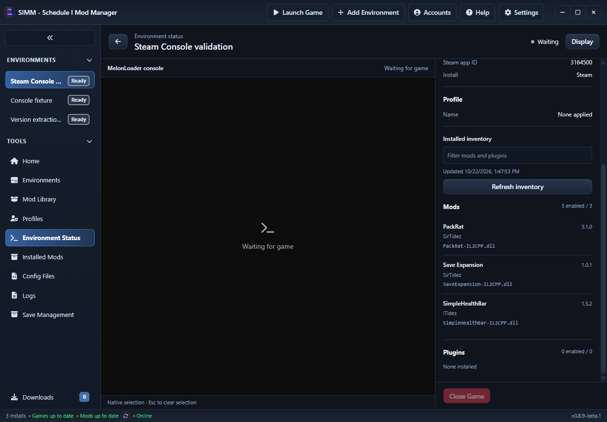

# Installed mod version extraction — 2026-10-22

The Environment Status inventory previously copied version fields from SIMM's install metadata. Manually copied/local mod DLLs often have no such metadata, even though their MelonInfo declaration contains a version. The sidebar consequently displayed Unknown version for all three installed local mods.

## Change

The status inventory now inspects every installed DLL returned by the existing mod/plugin enumerators, including nested mods and disabled DLLs. A bounded blocking task reads PE headers and CLR metadata directly; it does not load assemblies, execute attribute constructors, resolve dependencies, or require a .NET runtime. Large embedded asset/resource sections are not read.

MelonInfo supplies the declared mod name, exact version (including prerelease/build text), and author. Numeric version constructors and legacy MelonModInfo/MelonPluginInfo attributes are supported. A file without a usable loader declaration falls back to its own CLR AssemblyVersion. If the file cannot be inspected, existing install metadata remains available. A broken or versionless DLL stays in the inventory instead of preventing other files from being scanned.

The version tooltip identifies MelonInfo, assembly, or install metadata provenance. Refresh inventory rescans the files without restarting console attachment or issuing a game launch. This is a read-only projection for the status sidebar; it does not rewrite shared library/update-provider metadata.

PE range/size, CLR stream bounds and table allocations are checked before parsing, with a 64 MiB metadata limit. Asset-heavy DLLs may be much larger than this limit because their embedded resources are not metadata. No new production dependencies were added; the existing portex and clrmeta crates provide the readers.

[MelonLoader's modder documentation](https://github.com/LavaGang/MelonWiki/blob/master/docs/modders/quickstart.md) identifies the MelonInfo assembly declaration as the mod identity. Constructor signatures were also checked against the installed MelonLoader XML documentation.

## Tests

Authored compiled fixtures cover external and local attribute constructors, exact string versions distinct from AssemblyVersion, Unicode, numeric prerelease/stable versions, legacy plugins, disabled DLLs, unrelated attributes and decoy version strings, malformed/truncated files, invalid stream bounds and oversized table counts. The attribute constructors deliberately throw if executed; tests inspect their metadata with no dependency DLL beside the fixtures. Inventory tests verify stale cached version replacement, unreadable-file fallback and preservation of every row.

Frontend tests cover version-source labels and refreshing to a changed installed version without retrying console attachment or closing the game. The complete required validation sequence passed: 498 frontend tests, 646 Rust tests, 10 existing ignored Rust tests; lint completed with 27 advisory warnings and zero errors. TypeScript, frontend build and cargo check passed. Receipts: target/diagnostics/native-console-integration/mod-version-validation.

## Native application verification

Verified the real Tauri application against the installed game directory with Schedule I closed:

| Installed file | Declared name | Extracted version | Author | Source |
| --- | --- | --- | --- | --- |
| PackRat-IL2CPP.dll | PackRat | 3.1.0 | SirTidez | MelonInfo |
| SaveExpansion-IL2CPP.dll | Save Expansion | 1.0.1 | SirTidez | MelonInfo |
| SimpleHealthBar-IL2CPP.dll | SimpleHealthBar | 1.5.2 | iTidez | MelonInfo |

All three versions matched the prior loader output and rendered in the sidebar. Extraction did not depend on that log or a running game. This also confirms the installed PackRat version is used, rather than the different version in the development source checkout.

This image is a capture of the actual Tauri WebView with the game closed; it does not demonstrate live native console capture. The desktop capture was obscured by an unrelated application, which was left alone.

An isolated inventory with 105 entries verified active files, a disabled legacy plugin, a nested disabled mod, an assembly-only DLL and one invalid DLL. Every row remained present. Replacing Modern.dll with a rebuilt fixture and clicking Refresh changed its displayed version from 2.7.1-beta.4+local to 3.4.5. No game process existed before or after refresh, and no error alert appeared. Scrolling reached the last inventory row at 1280x800, 1920x1080, 2560x1440 and 3840x2160; the inspector stayed 360 px, root font 16 px, Close Game remained visible, and no horizontal overflow appeared.

UI receipts are under target/diagnostics/native-console-integration/status: real-mod-versions.json, version-refresh.json and versions-layout.json. The isolated SIMM app and its waiting helpers were closed afterward. No real mod, plugin or game configuration was written during this check. Windows/IL2CPP installed binaries and portable authored fixtures were checked; a live Mono game was not launched for this change.
