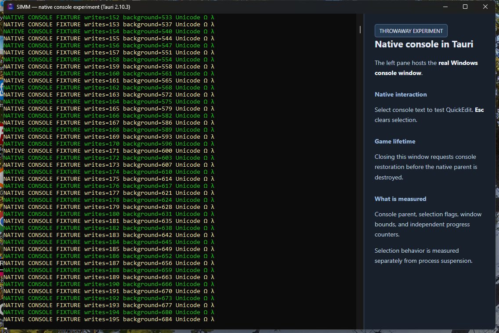
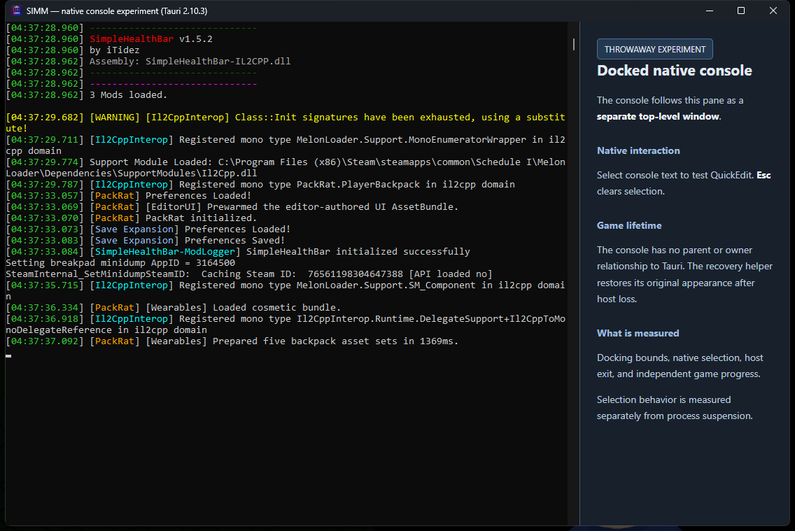

# MelonLoader console experiments — 2026-10-22

These are local Windows feasibility results, not a shipped SIMM feature or cross-platform qualification. Existing uncommitted application/tooling changes were preserved. Diagnostic sources and raw evidence are in ignored `target/diagnostics`; this document preserves the findings independently of that build-output directory.

## Proven behavior

| Approach | Steam launching | Native console | Capture | Host exit |
| --- | --- | --- | --- | --- |
| Attach to existing console and hide its window | Preserved | Exists; initially visible, then hidden | Actual Unicode/color screen-buffer snapshots worked | Normal close and forced capture-host termination restored the original console; same game process survived |
| `--melonloader.hideconsole` with native buffer capture | Preserved | No attachable console in the tested loader build | AttachConsole failed with error 6 in two launches | Game/mod initialization completed; capture helper exited without terminating game |
| Hidden console plus structured logger bridge | Preserved | No visible console observed | Managed logger callbacks delivered real mod messages, severity/source/color fields, Unicode and multiline text; registered mod metadata also delivered | Same game survived normal and forced host exit; Unity updates continued; bridge reconnected to a replacement host |
| Native console reparented into Tauri | Disposable fixture only | Actual native child console rendered | Native interaction retained | Normal close restored it, but forced Tauri exit destroyed the console window; rejected before testing with the game |
| Native console docked alongside Tauri | Preserved | Actual native console remains a separate, unowned top-level window | Native output, colors, scrollbar and Mark selection retained | Same console and game survived normal Tauri close and forced host termination, including recovery from a selected, blocked console |

The launch route for the latter two tests was `Steam.exe -applaunch 3164500 --melonloader.hideconsole`, supplied per launch. Steam's persistent launch options and Loader.cfg were not edited. Actual game-process command lines and Steam parent identity were verified.

## Structured bridge success and limits

A temporary MelonPlugin subscribed in `OnPreInitialization` to the installed loader's `MsgDrawingCallbackHandler`, `WarningCallbackHandler`, and `ErrorCallbackHandler`. Callbacks only enqueue; a bounded background transport sends JSON through a current-user named pipe to an independent host. The host verifies client PID, executable and start time. The bridge does not depend on a native console or use Latest.log as its capture source.

The live test captured PackRat, Save Expansion, SimpleHealthBar, assembly-generator, Il2CppInterop and MelonLoader messages. Synthetic warning/error messages were labelled intentional diagnostics. The mod metadata event reported PackRat 3.1.0, Save Expansion 1.0.1 and SimpleHealthBar 1.5.2.

After forced host termination, the same game PID/start time remained and Unity updates advanced from 25,696 to 27,345 over the eight-second follow-up. The first host recorded 129 events and the replacement 86. A 150-second classic-console observer recorded no console show events or visible samples.

One sequence number was lost across disconnect/reconnect (129 → 131). Delivery is **best effort**, and the prototype's queue-drop counter did not account for this failed-write loss. Production use needs explicit retention, ordering, overflow and acknowledgement/replay or loss accounting. Managed callbacks also exclude bootstrap output before subscription and native/Unity output that bypasses them.

## Cleanup completed

The bridge callbacks and worker were disabled before leaving the game running. Windows locked the loaded DLL until the user exited the game. After exit, hash-verified cleanup removed:

- `C:\Program Files (x86)\Steam\steamapps\common\Schedule I\Plugins\SimmLoggerBridgeProbe.dll`
- `C:\Program Files (x86)\Steam\steamapps\common\Schedule I\UserData\SimmLoggerBridgeProbe.session.json`

Both paths were verified absent. Loader.cfg bytes, persistent Steam launch options, branch and build match the baseline. No Steam restart or game termination was needed for cleanup. The current Plugins folder is empty; an original empty-inventory pipeline did not create its snapshot, so a whole-inventory equality assertion is intentionally omitted.

## Native Tauri embedding follow-up

The next probe bound an actual Windows console window to an isolated Tauri 2.10.3 host, matching SIMM's pinned version, using a separate restoration helper. No production SIMM UI changes were made.

Before using a Steam-launched game, a disposable console tests parent/child binding, sizing, selection, detach, normal close and forced host exit. Cross-process `SetParent` requires window-style handling and compatible DPI contexts; parent destruction is a separate lifecycle risk from merely hiding a window. The real game must not be exposed to an unproven crash-restoration path.

Console selection must be measured separately from process suspension. Blocking a console writer can stall a main loop that logs synchronously while independent threads continue. Retaining native QuickEdit behavior is not evidence of a reliable whole-process pause. No OS process-suspension feature or game pause implementation has been added.

The native path intentionally does not pass `--melonloader.hideconsole`, since that flag removes the attachable console in this installation. An initial visible console remains possible before attachment.

### Direct native embedding preflight results

The disposable console was successfully reparented as a visible native child of a real Tauri WebView window, beside an HTML sidebar. HWND ancestry, child style, matching DPI contexts and rendered pixels were verified. This was not a log renderer. Both probe projects built successfully after correcting an isolated Tauri feature/configuration mismatch.

| Probe | Result |
| --- | --- |
| Native child binding and rendering | Passed on the disposable fixture |
| Native Mark selection mode | Entered, confirmed by GetConsoleSelectionInfo flag 1 |
| Console writer during selection | Write count stayed at 503 for the two-second measurement |
| Independent thread during selection | Counter advanced from 1,759 to 1,825 |
| Clear selection | Writer resumed, reaching 512 |
| Normal Tauri closure | Original console parent/style/visibility restored; producer continued, writes 914 → 934 |
| Forced Tauri termination | **Recovery failed.** Native console HWND was destroyed. The producer survived and advanced writes 942 → 961, but the original console window could not be restored |

The crash case was tested only on a disposable producer. A real Steam game was **not** attached to the direct-reparenting host after this failure. The fixture and probe processes were stopped afterward; no game session was launched by this preflight.

This demonstrates the desired native interaction during normal use, but also demonstrates that a reactive external watchdog is insufficient to preserve a child console window when its Tauri parent dies. Direct SetParent embedding therefore fails the recovery acceptance gate and is not recommended as the current production route.

The selection experiment entered native Mark mode; manual mouse highlighting and clipboard copying were not separately accepted. Its counters prove console-writer blocking, not whole-process suspension. A game's main thread may stall if it writes synchronously to a selected console while other threads continue, so this must not be presented as a dependable process-pause feature.

The user approved a follow-up experiment docking the native console visually to Tauri while leaving it a separate top-level window. Its completed results follow below.

Raw preflight evidence: `target/diagnostics/tauri-console-probe/synthetic-ce99314f/normal/selection-test.json`, `normal/lifecycle-test.json`, and `forced/lifecycle-test.json`. The restoration controller and watchdog recorded the destroyed-window failure rather than claiming success from producer survival alone.

## Docked native console results

**The docked approach passed the tested Windows feasibility gates, including live recovery after forced Tauri termination.** The console stays a separate top-level window with no parent or owner relationship to Tauri. A controller aligns it with the Tauri client area beside an HTML sidebar, follows movement and resizing, and hides/restores it with minimization. It does not use `SetParent` in the docking or restoration paths.

The controller removes the console frame and applies `WS_EX_TOOLWINDOW` while clearing `WS_EX_APPWINDOW`. Those style bits were verified; a separate shell/taskbar visual acceptance test was not performed. Z-order coordination keeps the console immediately above the Tauri host without making either window globally topmost. The first live attempt exposed a blank pane because the console was behind Tauri. The corrected ordering was retested and the actual console pixels were verified in this screenshot:

This is the actual Steam-launched game's native console, including mod, loader, Unity and Steam output. It is not a recreation from Latest.log or managed logger callbacks. The sidebar is throwaway test UI, not the proposed production design.

### Disposable fixture gates

The disposable producer retained the same native console HWND through all three lifecycle tests. Original console styles, extended styles and visibility were restored, and its writer continued after each host/controller shutdown.

| Probe | Result |
| --- | --- |
| Native window identity | Parent 0, owner 0, not a child window |
| Move and resize following | Exact requested deltas: left +50 px, top +40 px, width +120 px, height +60 px |
| Minimize and restore following | Passed |
| Native Mark selection | GetConsoleSelectionInfo flag 1; writer stayed at 23 while the independent counter advanced 79 → 142; clearing selection resumed writes to 29 |
| Normal Tauri close | Same console restored; writes 394 → 414 |
| Forced Tauri termination | Same console restored; writes 420 → 440 |
| Forced docking-controller termination | Independent guard restored the same console; writes 446 → 465 |

A diagnostic-file sharing race in an earlier fixture run was corrected with delete-sharing reads and bounded atomic-save retries. The restoration guard recovered that fixture when its controller exited. The complete fixture gates above passed before attaching the real game.

### Live Steam launch and recovery

Steam launched the game with `Steam.exe -applaunch 3164500`. The console-hiding argument was omitted because it removes the attachable console in this installation. The game executable, Steam parent, PID and start time were checked. Both live lifecycle tests used the same game process: PID 54312, UTC start ticks 639282658459864140.

A temporary MelonPlugin measured Unity OnUpdate frames and a separate background-worker counter. It did not patch game state. It normally stayed silent; an explicit test request generated one clearly labelled synthetic MelonLogger write synchronously on Unity's main thread to measure console blocking. S1MCP was not exposed as a callable tool in this session, so these independent counters supplied the liveness evidence.

| Live lifecycle test | Result |
| --- | --- |
| Normal Tauri close | Original console window/styles/visibility restored; same game remained responsive; frames 64,649 → 65,305 over approximately 3 seconds |
| Forced Tauri termination while selection blocked a main-thread log write | Recovery cleared selection and restored the same console; the pending log completed; same game remained responsive; frames 65,525 → 66,136 over approximately 3 seconds |

The controller and independent guard both verify target identity. Recovery restores the console's original bounds, styles and visibility, and clears native selection so a blocked console write can finish. The experiment has bounded controller/guard leases of six/seven minutes; these are test safeguards, not production session behavior.

### What native selection actually pauses

Selection alone did **not** pause this game's idle menu. With native Mark mode active, Unity frames advanced 46,789 → 47,205 over approximately two seconds, and the independent worker advanced 2,233 → 2,252.

With selection active and a synthetic synchronous main-thread log write requested, frames stayed at 47,426 over the two-second measurement while the worker advanced 2,263 → 2,282. The log was still in progress. Clearing selection completed the log and resumed frames to 47,614.

This reproduces the user's observed game stall when the main thread writes to a selected console. It is conditional console-I/O blocking, not whole-process suspension: background work can continue. Native selection should therefore remain a console interaction, and should not be advertised as a dependable Pause Game control. No OS suspension, debugger attachment or Unity time-scale feature was implemented. Native Mark entry/readback was tested; manual mouse-drag highlighting and clipboard copy remain separate acceptance checks.

### Docked-test cleanup completed

After both recovery tests passed, the frame probe was disabled and the game was closed normally using its verified Unity window, under the user's existing testing permission. Hash-verified cleanup removed `Plugins/SimmDockFrameProbe.dll` and `UserData/SimmDockFrameProbe.session.json` from the installed game. Both files are absent, the original plugin inventory was restored, and no experiment processes remain.

Loader.cfg bytes, persistent Steam launch options, branch and build all match their pretest baselines. The game survived both host shutdown tests and was closed afterward for cleanup. No production SIMM source, IPC or UI integration was added by this docked-console experiment. Its prototype source remains under ignored `target/diagnostics`; the report and screenshots are preserved here.

### Remaining acceptance before a product feature

This validates a Windows companion-console direction on the installed IL2CPP/loader build. It does not establish seamless startup hiding, a reliable whole-game pause, or crash-proof behavior under every failure mode. Production integration still needs explicit session ownership/recovery, unbounded-session lifecycle design, focus/Alt-Tab/taskbar acceptance, mouse highlighting/copy, mixed-DPI and multiple-monitor behavior, and sustained gameplay testing. Mono, other loader versions and Linux/Proton are untested.

## Scope and evidence

Tested environment: Windows 11, Schedule I 0.4.7f12 IL2CPP x64, Steam beta build 25796331, MelonLoader 0.8.0-ci.2575. Mono, other loader versions, custom Steam shortcuts, Proton/Linux, long-duration behavior, multiplayer implications and manual gameplay acceptance remain open.

Local evidence:

- `target/diagnostics/console-capture-experiment/RESULTS.md`
- `target/diagnostics/console-capture-experiment/HIDDEN_STARTUP_RESULTS.md`
- `target/diagnostics/logger-bridge-experiment/RESULTS.md`
- `target/diagnostics/logger-bridge-experiment/live-11dd7a04/results.json`
- `target/diagnostics/logger-bridge-experiment/live-11dd7a04/cleanup.json`
- `target/diagnostics/logger-bridge-experiment/live-11dd7a04/cleanup-verification.json`
- `target/diagnostics/tauri-console-probe/` — current throwaway native embedding probe
- `target/diagnostics/tauri-console-probe/dock-synthetic-e6274515/normal/interaction-test.json`
- `target/diagnostics/tauri-console-probe/dock-synthetic-e6274515/lifecycle-results.json`
- `target/diagnostics/tauri-console-probe/dock-live-8d8f508d/normal-v2/game-selection-test.json`
- `target/diagnostics/tauri-console-probe/dock-live-8d8f508d/game-lifecycle-results.json`
- `target/diagnostics/tauri-console-probe/dock-live-8d8f508d/cleanup.json`

Reference APIs: [AttachConsole](https://learn.microsoft.com/en-us/windows/console/attachconsole), [SetParent](https://learn.microsoft.com/en-us/windows/win32/api/winuser/nf-winuser-setparent), [console selection](https://learn.microsoft.com/en-us/windows/console/console-selection), [SetWindowPos](https://learn.microsoft.com/en-us/windows/win32/api/winuser/nf-winuser-setwindowpos), [extended window styles](https://learn.microsoft.com/en-us/windows/win32/winmsg/extended-window-styles), [ClientToScreen](https://learn.microsoft.com/en-us/windows/win32/api/winuser/nf-winuser-clienttoscreen).
