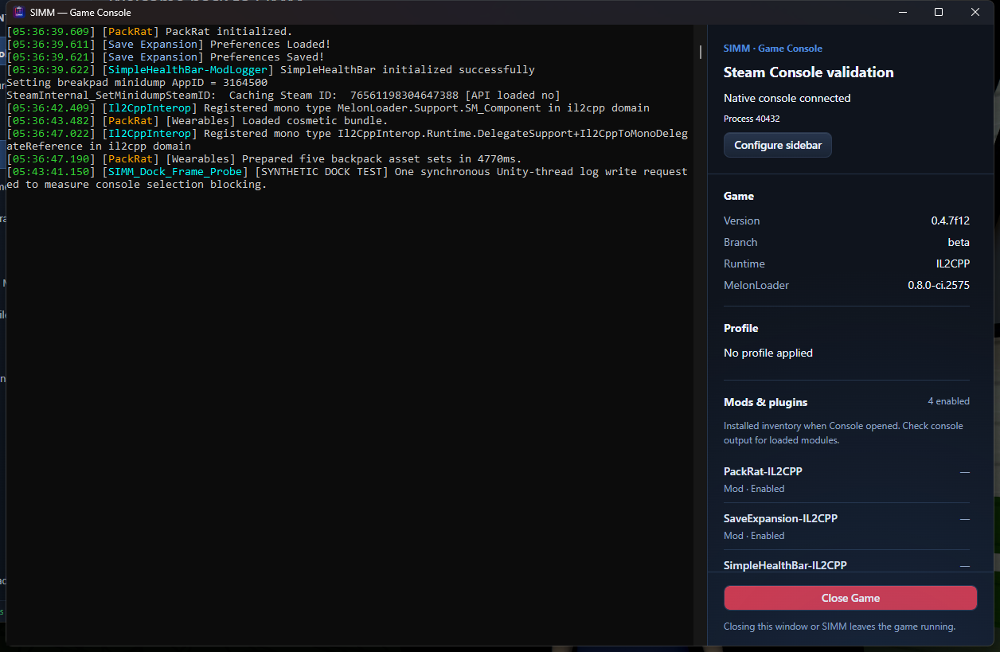
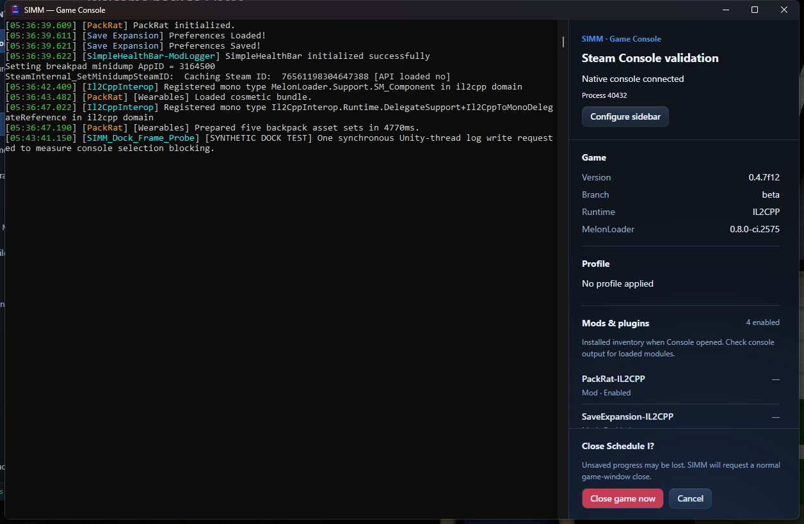

# Docked native console integration — 2026-10-22

The dedicated-window interface below is historical. The subsequent [environment status workspace revision](2026-10-22-environment-status-workspace.md) moves it into the main SIMM shell and refines the inspector.

The docked console is now integrated into SIMM's Windows GUI. The Steam launch route is preserved. Closing Console or SIMM restores the original console and leaves the game running. The new sidebar provides an explicit, confirmed Close Game action.

## Using it

- Console opens automatically after a successful GUI launch request by default. Disable automatic opening under Settings → Game Console or Configure sidebar.
- Completed Windows environment cards include a Console button. It observes an existing or starting game; it never dispatches another launch.
- Configure sidebar saves visibility of game details, active profile, installed mods/plugins and the game folder path. Width choices are 280, 360, 440 and 520 logical pixels.
- Profile and inventory describe the environment when Console opened. Inventory enabled state is not proof a module loaded; the native console remains the source for actual loader output. Missing version metadata is shown as unknown.
- Close Game opens an inline themed confirmation in the sidebar. Cancel does nothing to the game. Confirmation clears native selection and posts a normal close request to the exact attached process's Unity window. There is no automatic force termination of the game. If a valid Unity window cannot be identified, the sidebar reports the failure.
- Closing Console or quitting SIMM does not invoke Close Game. Native console selection is retained, but can block only threads performing console I/O; it is not a dependable whole-process pause.

## Implementation

`services/native_console.rs` owns environment sessions, independent preferences in SQLite app_meta, profile/inventory snapshots and dedicated Tauri windows. Thin commands and matching Rust/TypeScript DTOs expose the workflow through ApiService. The Console route avoids instantiating the main app's stores and background UI work again. Its capability includes only core window operations; backend game actions validate the caller's environment window.

The existing launch command dispatches through the original FileSystemService/Steam path, then schedules optional Console opening independently. Neither persistent Steam options nor per-launch arguments are changed. Failure to dock does not convert an accepted launch request into failure. Waiting and unavailable states are nonmodal, and Retry reattaches without relaunching.

`services/native_console/windows.rs` implements controller and recovery-guard modes of the installed SIMM executable. These run before CLI parsing, single-instance setup, WebView creation or application service initialization. No .NET runtime, plugin or external capture executable is required by the integrated feature.

The console remains an unowned top-level window. No SetParent or owner assignment is used. The controller follows client geometry and ordinary Z order, applies tool-window styling, and follows minimize/restore. Process identities include executable path, PID and creation time. A restoration plan and independent guard are established before styles change. Normal shutdown requests restoration; process/window loss is recovered outside SIMM. The guard can terminate only its verified controller if it has not exited, never the game. Recovery clears selection and restores bounds/styles/visibility. Sessions have no fixed-duration lease. Retry uses fresh control files so an exiting old guard cannot interfere with a replacement controller.

The first fixture run found an overly strict comparison of window styles: asynchronous hide changes WS_VISIBLE. Verification now checks the intended frame/tool-window bits independently. A short heartbeat timeout also caused an unnecessary detach; it was removed in favor of process/window-loss recovery, since console selection may deliberately delay I/O. Both corrections were retested before using the game.

## Validation results

Test environment: Windows 11; Tauri 2.10.3; Schedule I 0.4.7f12 IL2CPP; Steam beta build 25796331; MelonLoader 0.8.0-ci.2575. Validation used an isolated SIMM database under target/diagnostics. Existing unrelated working-tree changes were preserved.

### Disposable producer

| Check | Observed result |
| --- | --- |
| Native window identity | Visible, parent 0, owner 0, not a child; tool-window flag set and app-window flag cleared |
| Move/resize | Exact deltas: +50 px left, +40 px top, +120 px width, +60 px height |
| Minimize/restore | Console hid and returned with its Tauri host |
| Native Mark selection for eight seconds | Writes stayed at 4,600; independent worker advanced 16,183 → 16,442; clearing selection resumed writes to 4,605; no timed detach |
| Console-window close | Same console restored; writes 4,698 → 4,721 |
| Normal SIMM exit | Same console restored; writes 4,899 → 4,922 |
| Forced SIMM termination | Same console restored; writes 5,097 → 5,117 |
| Forced controller termination | Independent guard restored the same console; writes 5,290 → 5,310 |
| Retry after controller loss | Sidebar reported attachment loss; Retry reattached the same producer without a launch |
| Close Game with no Unity window | Explicit error; producer remained alive; no unrelated process closed |
| UI preferences | Game section toggled and persisted; 440 px width saved; restored to 360 px and game details visible afterward |
| Desktop layout | 1920×1080, 2560×1440 and 3840×2160 frontend viewports: 360 px sidebar, 16 px root font, no horizontal overflow, visible Close Game, scrolling details |

Viewport checks validate frontend layout. Native alignment was separately measured in the actual Tauri fixture. These are not mixed-DPI or multiple-monitor acceptance.

### Live Steam game

The real environment-card Launch button dispatched the existing Steam route. The automatically opened Console attached to game PID 40432, UTC start ticks 639282693836858813. Steam parent PID 39296 was unchanged, and the game command line contained no hide-console argument. Real PackRat, Save Expansion and SimpleHealthBar output rendered in the original native window beside the sidebar.

| Check | Observed result |
| --- | --- |
| Console-window close | Same game/console survived; Unity frames 20,788 → 21,487 |
| Normal SIMM exit | Original console restored; same game frames 36,578 → 37,278 |
| Forced SIMM termination while native selection blocked a synchronous Unity-thread test log | Frames stayed 82,644 during selection while the worker advanced 3,974 → 3,993. Recovery cleared selection, completed the pending write, restored the console and resumed frames to 83,242 |
| Restart SIMM and reopen Console | Reattached to the same game and original console, without another launch |
| Close Game → Cancel | Same game PID/start time remained alive |
| Close Game → confirm | Sidebar observed game exit in 2,393 ms; no game force-kill was used |

The screenshot contains a clearly labelled synthetic test write and a temporary frame-observer plugin in the installed inventory. They were validation instrumentation and are not part of the integrated feature.

### Cleanup

The sidebar closed the game normally. Hash-verified cleanup removed the temporary SimmDockFrameProbe DLL and its session JSON. Original plugin inventory, Loader.cfg hash, Steam launch options, branch and build all matched their baselines. No helper processes remained, and the isolated SIMM instance was closed afterward. The feature installs no game plugin.

### Automated checks

The full AGENTS.md sequence passed: bun install, TypeScript, lint, frontend tests/build, cargo check and cargo test. Frontend: 44 files and 493 tests passed. Rust: 637 passed, 10 existing tests ignored, no failures. Lint completed with 27 advisory warnings and no errors. Complete final receipts are under `target/diagnostics/native-console-integration/validation/`. The IPC scanner found no frontend command missing a registered backend handler.

Raw native and UI evidence is under `target/diagnostics/native-console-integration/`, including fixture lifecycle receipts, layout/preferences results, live lifecycle receipts, close-game-ui.json and cleanup.json. The prototype test scripts and isolated database are ignored build diagnostics; shipping implementation is in src and src-tauri.

## Limits

Native docking is explicitly Windows-only; Linux launch behavior is unchanged. Mono, other loader builds, Linux/Proton docking, mixed-DPI/multiple-monitor behavior, shell taskbar/Alt-Tab acceptance and long gameplay/multiplayer sessions were not qualified. Native Mark mode was exercised; manual mouse-drag highlighting and clipboard copy remain user acceptance checks. A separate console can still appear before attachment. No structured logger bridge, telemetry collection, reliable game-pause control or automatic game force-kill was added.
