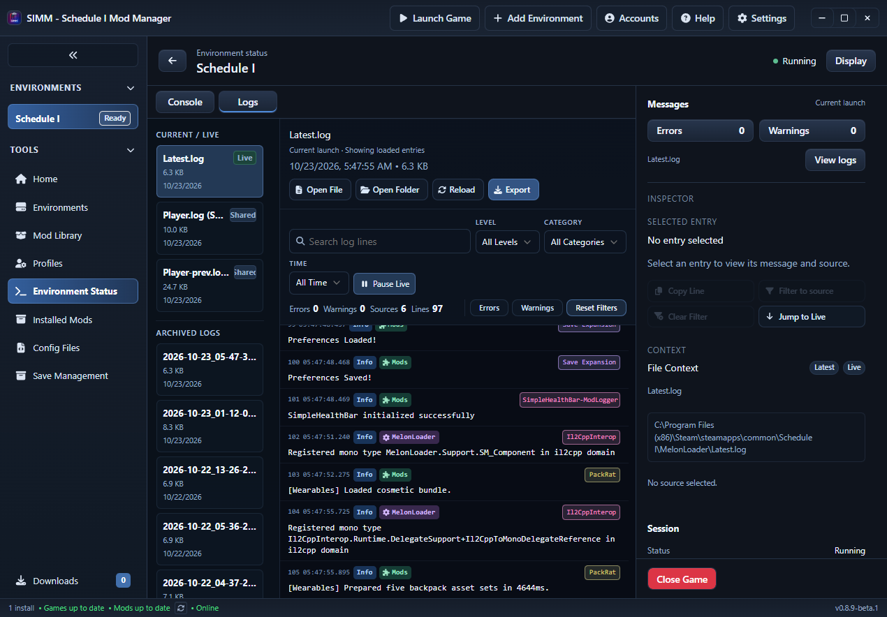
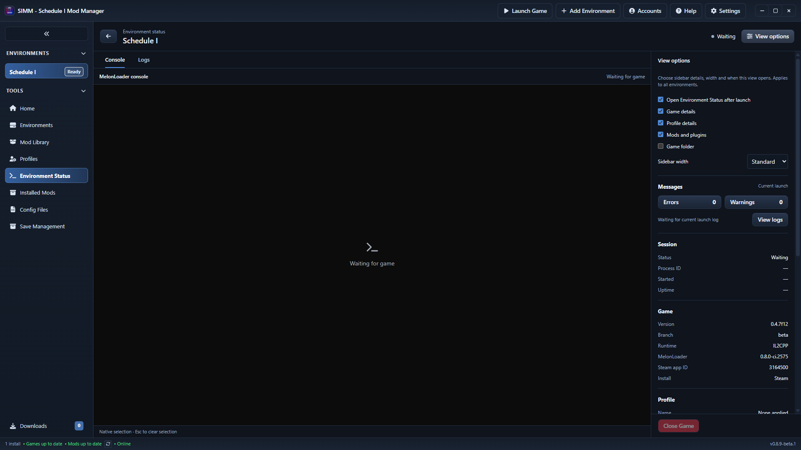

# Environment Status: Console and Logs

Environment Status now contains Console and Logs tabs with one shared details sidebar. The separate Logs navigation item has been removed. Existing log links, including launch-status actions, open the Logs tab for the selected environment.

## Behavior

- Console retains the existing Windows native companion window and Steam launch route. Changing tabs changes its viewport visibility; it does not close the game or restart the console controller.
- Logs retains current and archived files, shared Unity Player logs, search, severity/category/time filters, export, multiline inspection, live updates and access to earlier entries. The selected message and file context appear in the shared sidebar.
- Game, profile, inventory, authors, versions, enabled state, message counts and the confirmed Close Game action remain in the same sidebar. Its details scroll independently of the action area.
- Clicking an error/warning count selects Logs, Latest.log, the requested severity and every known source alias attributed to that installed mod/plugin. A global count clears the source filter. Search/category/time filters reset for this navigation so they cannot hide the requested messages.
- Switching back and forth retains Logs filters, selection and loaded history. Its live watcher stops while Console is displayed and refreshes when Logs returns. Native selection is cleared by the existing helper when its window hides, preventing a selected hidden console from blocking game logging.
- Linux keeps access to Environment Status and Logs. Native Console is disabled there, with no attempt to open the Windows companion. Game metadata remains available without a native session.

## Consistent severity and source attribution

The sidebar diagnostics and MelonLoader log reader now share header interpretation and the exact expected interop startup-notice rule. MelonLoader severity comes from its header before the source. Ordinary info quoting a literal `[ERROR]` stays informational. A message emitted by Il2CppInterop remains attributed to Il2CppInterop even if its text mentions an installed mod.

Only the exact known `Class::Init signatures have been exhausted, using a substitute!` warning is informational, with optional final exclamation mark. Different warnings, all errors and additional nonempty multiline context remain actionable. The entry remains visible in Logs and the original file is unchanged. Other log formats retain their existing parser.

Sidebar counts cover the current launch. Logs labels current-launch, latest saved, archived and shared files, and identifies its summary as loaded entries. The initial bounded tail is 4,000 physical lines; Load earlier entries makes older messages available even when the active filter currently finds nothing. Export applies all selected source aliases to the complete file.

## Real Steam verification

An isolated SIMM data directory contained only the real Steam Schedule I environment. Schedule I 0.4.7f12, IL2CPP, Steam beta build 25796331 and MelonLoader 0.8.0-ci.2575 were exercised with the existing PackRat, Save Expansion and SimpleHealthBar installations. No test console, injected log messages or temporary mods/plugins were used for this verification.

| Check | Result |
| --- | --- |
| Launch from SIMM | Game PID 15964 was launched by Steam PID 39296 |
| Console -> Logs | Original native console HWND 3939904 hidden; game, controller and console identities unchanged |
| Logs -> Console | Same console became visible; remained an independent top-level window with no parent or owner |
| Native Mark selection | Selection flags became 1 in Console; opening Logs hid the window and cleared selection to 0 |
| Close SIMM while Logs active | Same game remained alive and original native console was restored visibly |
| Restart SIMM | Reattached to the same game without another launch |
| Current launch counts | Sidebar and complete parsed Latest.log both contained 0 errors / 0 actionable warnings |
| Count navigation | Global Errors opened Logs with Error severity and Latest.log selected |
| Shared Close Game | Confirmed action from Logs closed the game normally |
| Layout | 1920x1080, 2560x1440 and 3840x2160: stable 16px root font, no horizontal overflow, shared inspector, visible Close Game and accessible final sidebar section |

Nonzero mod/plugin count navigation, alias grouping, multiline updates, filtered export and remount-free navigation are covered by regression tests. This clean launch did not produce nonzero mod/plugin errors or warnings. Native selection flags verify the console feature, not a guaranteed whole-game pause; mouse-drag selection, mixed-DPI/multiple-monitor behavior, Mono and Linux runtime acceptance remain untested in this run.

The game and isolated SIMM instance were closed after testing. Original Mods/Plugins inventories and file hashes, and Loader.cfg, matched their baseline. Steam changed its own appmanifest during the launch; current branch/build remained beta/25796331. The game wrote its normal logs. No manual log replacement or game DLL/configuration edits were performed.

## Validation evidence

The full AGENTS.md frontend and Rust validation sequence and custom-protocol desktop build passed: 530 frontend tests and 671 Rust tests, with 10 existing ignored Rust tests. Lint reported 27 advisory warnings and no errors. The IPC checker found no frontend command missing a registered backend command. Existing advisory boundary warnings remain. One earlier full Rust run hit the existing protected-directory deletion assertion; subsequent complete runs passed without modifying that service or test.

Final command receipts are in `target/diagnostics/native-console-integration/status-tabs-validation/`. Native window/selection, layout, count comparison, cleanup, screenshots and custom-protocol build receipts are in `target/diagnostics/status-tabs-ui/`.

The layout test initially used an obsolete row selector and was corrected. The native-selection inspection initially detached the calling shell console and prevented the following Node process from starting; repeating each inspection in its own shell completed the checks. These failures were in the validation helpers and did not require a production workaround.

## Tab styling and View options refinement

Console and Logs now use flat text tabs with a 2px underline for the selected view, a keyboard focus outline, and no rounded action-button background. Display is renamed View options with a sliders icon and a descriptive tooltip. Its panel explicitly labels sidebar width, the individual visible sections, and automatic opening of Environment Status after launch. A short note explains that these settings apply to all environments. Opening the panel scrolls it into view and focuses it; the button is disabled until preferences are available.

The frontend validation sequence passed again with 530 tests, 27 advisory lint warnings and no errors. The rebuilt Tauri app passed 1080p, 1440p and 4K checks for flat tab styles, active underline, keyboard navigation, a stable 16px root font, no overflow, and options visibility/focus after scrolling the sidebar. Game details were toggled and restored, and sidebar width changed to 440px and back to 360px through the actual saved preferences. The isolated app was closed afterward. Evidence is under `target/diagnostics/status-tabs-style/`; an initial exact-label lookup for the width selector was corrected to its accessible combobox role and name.

