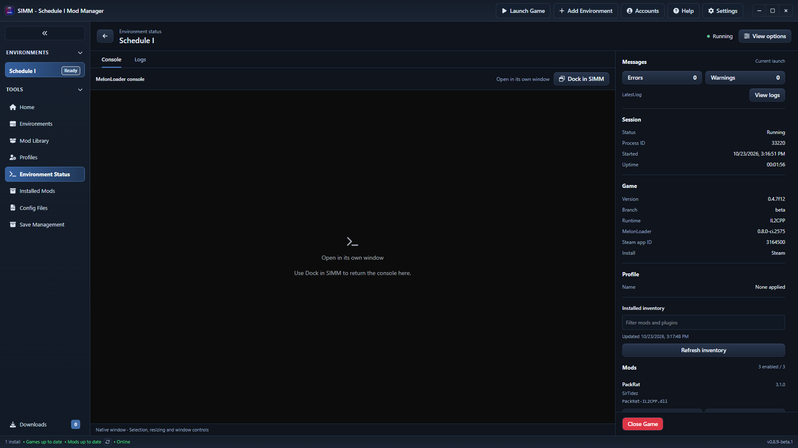

# Per-environment View options and native console pop-out

View options are now saved per environment, and the native console can be released into its normal Windows window and docked back into SIMM.

## Environment preferences

Sidebar sections, width and automatic opening after launch use an environment-specific record under `app_meta`, keyed by `native_console_preferences:<environment id>`. The environment must exist before its preferences can be read or saved.

The first read seeds that environment from the previous app-wide record, or the built-in defaults if there was no record. Existing environment-specific values win. The old record is retained for migration; the frontend no longer edits it. Saving updates only the matching live console session and its preferences file. Other environments retain their own configuration. The launch path reads the launched environment's auto-open setting.

View options explains that its values are saved for the current environment. General Settings directs users to the selected environment's Environment Status -> View options rather than presenting an app-wide editor.

Regression tests cover inheritance, durable independent values, independent auto-open flags, width clamping, unknown environments and updates to only the selected live session. Frontend tests cover addressed IPC calls, the selected environment's save, pop-out/redock, failure reporting and rejection of stale snapshots after a successful presentation/layout update.

## Native pop-out

The Console toolbar offers **Pop out console** after attachment. It stops the docking controller and waits for the existing recovery path to restore the original native console. Its original frame, system menu, taskbar style and bounds are restored, and the explicit pop-out action makes the window visible. **Dock in SIMM** reconnects to the same running game and console using a fresh controller directory. Neither action relaunches the game.

The session remains available to the sidebar and Logs. Inventory refresh and navigation preserve pop-out mode; a viewport cleanup does not hide the independent window. Redocking clears active selection before hiding/moving the console so a hidden selection cannot leave a log writer blocked. Restoration must be acknowledged before a replacement controller starts; a pending restore produces an error instead of starting a competing controller.

Pop-out mode lasts for the current SIMM session. After restarting SIMM, manually opening Environment Status attaches again. It is separate from the persisted layout and auto-open setting. The standalone console uses its native window controls, including Windows' normal console-close behavior; SIMM does not intercept that native close action. Closing SIMM leaves the game and console running.

## Live Steam verification

Testing used an isolated SIMM database containing the real Steam Schedule I environment. No console producer, injected log messages or temporary mod/plugin assemblies were used. The installed IL2CPP game was Schedule I 0.4.7f12 with MelonLoader 0.8.0-ci.2575 and the existing PackRat, Save Expansion and SimpleHealthBar mods.

| Check | Result |
| --- | --- |
| Save through View options | Auto-open disabled and 440px sidebar saved for `console-live`; legacy defaults remained enabled/360px |
| Restart SIMM | Environment settings persisted |
| Launch through SIMM | Steam PID 39296 launched game PID 33220 with its existing `-beta` argument |
| Auto-open disabled | SIMM remained on Home; manual Environment Status opened later |
| Pop out | Same native console HWND 826482090, original style/ex-style restored exactly, no parent or owner |
| Native move/resize | Console retained requested 80,80 position and 900x620 size |
| Native minimize/restore | Both worked while the same game stayed alive |
| Inventory/navigation | Refresh inventory and Home -> Environment Status retained pop-out mode and native geometry |
| Logs while popped out | Current launch counts matched Latest.log: 0 errors and 0 actionable warnings |
| Native selection -> redock | Selection flags 1 -> 0; same game PID/start time and console HWND; controller replaced |
| Close SIMM while popped out | Original normal console stayed visible and game remained alive |
| Reopen SIMM | Saved environment values persisted; manual attachment reconnected to the same game |
| Close Game from Logs while popped out | Confirmed sidebar action closed the game normally |
| Layout | 1080p, 1440p and 4K: stable 16px root font, 440px sidebar, no page or console-toolbar overflow |

The test preferences were restored in the isolated database. The game and all SIMM test processes were closed. Original Mods/Plugins inventories, all DLL hashes and Loader.cfg matched their baselines. Only normal game/Steam activity wrote the game logs and Steam state.

Native Mark selection was verified through Windows selection flags. Mouse-drag selection, clipboard copy and whole-game pausing are not newly qualified by this run. Native docking/pop-out remains Windows-only; Linux/Proton and Mono runtime testing were not performed. Per-environment persistence uses the shared cross-platform SQLite service, while the existing Linux Logs access is retained.

## Validation

The AGENTS.md sequence passed: install, TypeScript, lint, frontend tests/build, Cargo check and Cargo tests. Frontend: **535 tests passed** across 47 files. Rust: **674 passed**, 10 existing ignored tests. Lint retained 27 advisory warnings and no errors. Cargo check/tests and the custom-protocol desktop build passed again after the final native selection adjustment. Formatting and IPC command-registration checks passed.

Evidence is in `target/diagnostics/native-console-integration/environment-console-validation/`, `target/diagnostics/environment-console-final-{check,test}.log`, `target/diagnostics/environment-console-desktop-build.log` and `target/diagnostics/environment-console-ui/`.

The initial live checks exposed timing assumptions in the validation helper: a controlled checkbox changed after the save response, and native-session initialization completed after navigation. The helper now waits for confirmed state. It also skips an already completed pop-out rather than searching for the replaced button. The backend test fixture initially omitted required timestamp fields; those fields were supplied. These corrections did not require a Steam launch workaround or a different console implementation.
