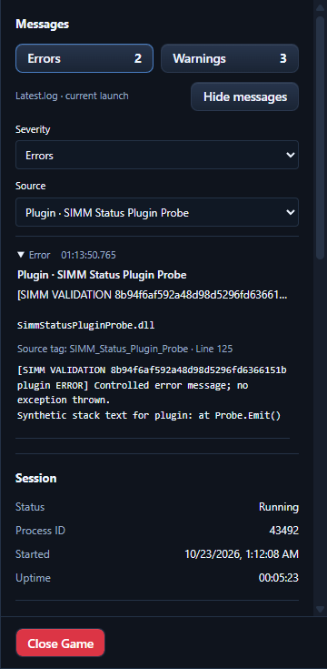

# Live Steam validation of status messages — 2026-10-23

The live comparison passed after correcting a parser bug exposed by actual MelonLoader output. The final sidebar and an independent read of the same launch's Latest.log both showed **2 errors and 3 warnings**, with matching message text, timestamps, line numbers and mod/plugin source attribution.

## Launch and test scope

Schedule I was launched from SIMM's Steam environment card. Its executable was the installed Steam copy, its parent was the already-running Steam process, and no console-hiding argument was added. The observed installation was Schedule I 0.4.7f12 IL2CPP, Steam beta build 25796331, MelonLoader 0.8.0-ci.2575. Game PID 43492 remained the same throughout the initial comparison, SIMM rebuild/reconnection and successful recheck.

The existing installed mods were PackRat 3.1.0, Save Expansion 1.0.1 and SimpleHealthBar 1.5.2. Two small temporary assemblies, SIMM Status Mod Probe and SIMM Status Plugin Probe, were compiled against the installed loader. Each emitted one clearly labelled warning and one error through its own MelonLoader logger, with Unicode and multiline content. Error calls only wrote messages; no exception was thrown and no gameplay state was patched. Each also emitted an ordinary info message beginning with a literal [ERROR] token. Request files triggered these calls after startup so the first sidebar observed actual new game-generated log entries.

No one wrote or replaced Latest.log manually. The independent comparison parsed explicit severity in MelonLoader's file format, then compared every warning/error's level, source, timestamp, line number and complete text with SIMM's snapshot. The rendered sidebar's counts and filtered message details were checked separately.

## Bug found and fixed

The initial sidebar showed 4 errors and 3 warnings against the log's 2 errors and 3 warnings. MelonLoader writes ordinary instance messages as:

```text
[time] [Source] message
```

Warnings/errors use:

```text
[time] [WARNING or ERROR] [Source] message
```

The reader had accepted severity after the source as an alternate header layout. It therefore counted the probes' ordinary info messages, `[time] [Source] [ERROR] ...`, as errors. The earlier explicit-INFO fixture did not cover this actual loader format.

The parser now accepts severity only in its header position before the source, and treats every bracket after a source as message text. A regression test uses the exact live format, including ordinary info messages quoting both ERROR and WARNING. Genuine repeated events, multiline text and loader-source handling retain their coverage.

SIMM was closed normally for the rebuild while the same Steam game stayed running. Its process identity and advancing Unity update counters were verified. The rebuilt app then reattached to that process and reread its existing log, without another Steam launch.

## Final comparison

| Source | Errors in log/sidebar | Warnings in log/sidebar | Attribution |
| --- | --- | --- | --- |
| Il2CppInterop | 0 / 0 | 1 / 1 | Loader · Il2CppInterop; natural startup warning |
| SIMM Status Mod Probe | 1 / 1 | 1 / 1 | Mod · SIMM Status Mod Probe; SimmStatusModProbe.dll |
| SIMM Status Plugin Probe | 1 / 1 | 1 / 1 | Plugin · SIMM Status Plugin Probe; SimmStatusPluginProbe.dll |
| Total | **2 / 2** | **3 / 3** | No mismatches |

Both quoted-severity info messages were excluded. Multiline continuations and Unicode survived exactly. The UI's severity/source filters isolated each real probe's error, displayed its correct DLL filename, and rendered full text equal to Latest.log. These are controlled mod/plugin messages rather than failures attributed to the user's installed mods.



## Cleanup and regression checks

The game was closed through the sidebar's confirmed Close Game action. The isolated SIMM instance was then closed. Hash checks verified both temporary DLLs before removal, and the matching expiring session file was removed. The original recursive Mods/Plugins file inventory and hashes were restored. Steam's PID/start time, launch options, Loader.cfg hash, branch and build remained unchanged. No game, SIMM controller or guard process remained.

The complete AGENTS.md sequence passed after cleanup: bun install, TypeScript no-emit checking, lint, frontend tests, frontend build, Cargo check and Cargo test. There were 511 passing frontend tests across 47 files and 657 passing Rust tests, with 10 existing ignored tests. Lint reported 27 advisory warnings and no errors. The custom-protocol Tauri build and all ten focused log-reader tests also passed. Final command logs are under target/diagnostics/native-console-integration/live-messages/validation/.

Local machine-readable receipts are under target/diagnostics/native-console-integration/live-messages/run-8b94f6af592a48d98d5296fd6366151b/: initial-comparison.json records the failure, recheck-comparison.json records the successful field-by-field comparison and UI checks, and cleanup.json records restoration. Original/final logs and screenshots remain local in that evidence folder. This run validates the installed Windows/IL2CPP/loader combination; Mono and Linux were not exercised.

## Expected startup notice excluded from actionable warnings

At the user's request, the sidebar now excludes this specific routine startup message from its warning count and message list:

```text
[WARNING] [Il2CppInterop] Class::Init signatures have been exhausted, using a substitute!
```

The exception requires warning severity, the Il2CppInterop source and the exact message (case-insensitive, with optional final exclamation mark). Other Interop warnings, all errors, changed wording, extra text, messages from other sources and missing source tags remain visible. If additional nonempty multiline context follows that exact first line, the reader restores it as a warning with its original timestamp, line number and complete text. Filtering does not change Latest.log or the Logs workspace.

The raw live-test log above still contains two errors and three warnings. Replaying those captured bytes through the updated real Tauri app produced **two errors and two actionable warnings**, excluding only the startup notice. Adding a different synthetic Interop warning and an Interop error with the same familiar wording increased the counts to three errors and three warnings; both retained Loader attribution. A subsequent warning with the startup phrase plus additional context increased warnings to four and displayed that context. The captured source log's SHA-256 remained unchanged.

All required checks passed again: 511 frontend tests, 660 Rust tests with 10 existing ignored tests, TypeScript, lint, frontend build, Cargo check and the custom-protocol Tauri build. Lint retained 27 advisory warnings and no errors. Three additional reader tests cover the exact exclusion, serious/source/severity boundary cases, unchanged source bytes and multiline promotion. Replay evidence is in target/diagnostics/native-console-integration/status/interop-notice.json, with command logs in interop-notice-validation/. The isolated replay app and disposable console producer were stopped afterward; no game or SIMM test processes remained.
