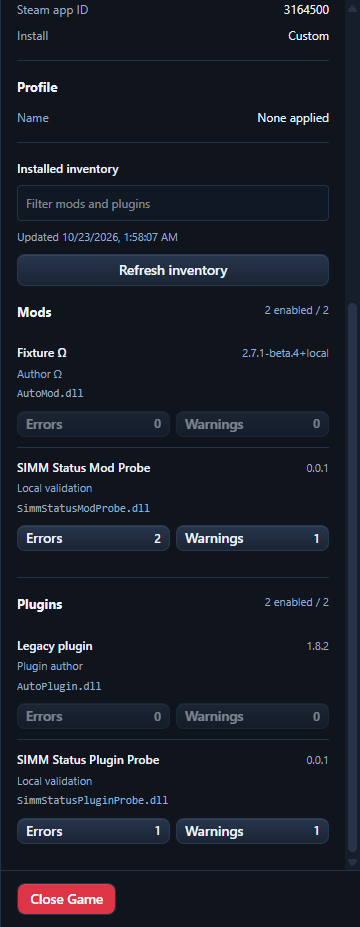

# Per-mod and plugin message counts — 2026-10-23

Each installed mod/plugin row now shows Errors and Warnings counts. Nonzero counts open the existing message viewer for that inventory entry and severity, focus its heading, and scroll it into view. The inventory search remains intact. Zero counts are displayed with disabled buttons. Global Errors/Warnings buttons clear the entry filter.

Counts use backend attribution and include all source tags matched to the same DLL and kind. A mod and plugin sharing a filename have separate identities. Unidentified and loader output stays in the overall message viewer rather than being assigned to a mod/plugin row. Inventory refresh updates attribution using the current metadata.

The backend keeps per-source counters independently of the 500 retained messages. Counts therefore survive retention eviction and reset with the existing process/log generation. The viewer groups aliases for an attributed entry and reports retained versus total matching messages. If no matching text remains, it identifies Latest.log as the earlier-message source. The specific routine Il2CppInterop startup notice remains excluded; other Interop warnings and all errors retain the existing policy.

The snapshot contract adds a camelCase sources array containing each raw source, its current origin and error/warning totals. Rust and TypeScript definitions agree. Row clicks change local viewer state; they do not launch/retry a game or change console attachment.

## Validation

TypeScript, lint, frontend tests, frontend build, Cargo check and the normal final Cargo test run passed. There were 513 frontend tests across 47 files and 661 Rust tests, with 10 existing ignored tests. Lint reported 27 advisory warnings and no errors. The custom-protocol Tauri build passed, and the IPC scan found no frontend command missing a backend registration.

Earlier normal Rust runs each had one failure in unchanged tests: the process-query timeout test, then a storage-mod test during temporary database promotion. The process-query test passed alone. Every test passed in a serial isolation run and in the subsequent normal full run. These intermittent failures and the successful runs are preserved in target/diagnostics/native-console-integration/row-counts-validation/; their underlying cause was not changed as part of this feature.

Focused coverage includes grouping aliases, mod/plugin identity separation, unmatched sources, row navigation and focus, live updates without losing the selected source, global-filter reset, full totals after message eviction, attribution changes, and source-counter reset on log replacement.

## Tauri fixture validation and its limits

This was a real Tauri UI test with replayed log data, **not another live Schedule I/MelonLoader launch**. The test used an isolated SIMM database and a disposable native console program. That program prints NATIVE CONSOLE FIXTURE counters and Unicode characters to check attachment and process continuity; those lines are synthetic and are not MelonLoader output. The sidebar independently read a copy of the captured Steam log and explicitly synthetic appended records. Normal bun/Vitest and Cargo unit test commands do not launch this interactive fixture; it was started explicitly by the diagnostic harness.

The replay first showed one error and warning on each of the captured test mod/plugin rows. An alias added a second error to the mod's existing row; unmatched output changed only overall totals. Adding 510 later plugin warnings left the plugin row at 511 warnings even after only 500 messages remained. Clicking the earlier mod's error count still selected that mod and explained the absence of retained text. Clicking the plugin count displayed 500 of its 511 matching warnings.

| Check | Result |
| --- | --- |
| Row actions | Correct attributed DLL and severity, aliases grouped, heading focused |
| Live polling | Counts updated and viewer selection persisted |
| Retention | Full source totals retained; 500 of 511 matching plugin warnings shown |
| Layout | 1280×800, 1920×1080, 2560×1440 and 3840×2160: no horizontal/row overflow, 16 px root font, last section reachable, Close Game visible |
| Disposable console | Same process/window remained connected; writes advanced 554 → 608 during the final scenario |
| Cleanup | Isolated app closed, producer survived host exit then stopped through its own control, two copied inventory fixtures hash-verified and removed, no SIMM/game-named test processes remained |

Machine-readable evidence is in target/diagnostics/native-console-integration/status/row-counts.json and row-counts-cleanup.json. The real game installation was not modified during this row-control test. The earlier [live Steam test](2026-10-23-live-status-messages.md) established actual logger-to-message attribution before these row controls were added. A fresh live Steam check of the new row controls has not been performed.

Following the user's objection to the visible fixture console, further visible console checks should use the actual Steam/MelonLoader session. Parser and component fixtures should remain in noninteractive tests rather than repeatedly showing the disposable console on the desktop.
