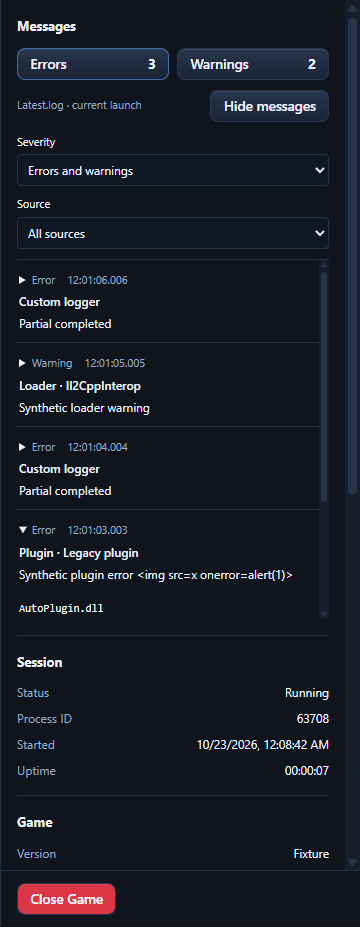

# Environment Status errors and warnings — 2026-10-23

The sidebar now shows live Errors and Warnings counts. Either count opens a message viewer filtered to that severity; View messages opens both. The viewer supports source filtering, expandable multiline text, timestamps, source tags, log line numbers, and matched mod/plugin names and DLL filenames. Native console selection and the existing Close Game control remain available.

Messages come from the selected environment's MelonLoader/Latest.log through the existing session snapshot poll. This is local, in-memory observation, independent of the Logs workspace's active watcher and the opt-in telemetry collection/upload services. No game-side bridge, injection, launch argument, Steam launch change, or game-process ownership change was introduced.

## Reading and attribution

- Only explicit WARNING/WARN and ERROR/FATAL header tags increment counts. Severity words in ordinary text do not. A multiline message counts once, while repeated emissions count separately.
- Source tags match installed names or DLL basenames after case/separator normalization. Only a unique inventory match is labelled Mod or Plugin. Known loader tags are labelled Loader, and Unity is labelled Game. Unknown, custom, missing or ambiguous tags retain their available text and remain unidentified rather than being assigned using stack traces or message text. This identifies a logger source; it does not prove that source caused the underlying failure.
- Counts reset when the observed process ID/start time changes or the log is replaced/truncated. A log whose modification time precedes process start is held as waiting, so a previous launch's log is not immediately shown as current.
- Reads run off the async executor, are incremental and limited to 256 KiB per snapshot. A backlog is labelled Reading Latest.log. UTF-8, UTF-16 LE/BE, incomplete character writes and multiline continuations are supported. Incomplete lines wait for a newline.
- The latest 500 warning/error messages are retained, with at most 16 KiB of displayed text per message. Counts include earlier evicted messages, and the viewer labels omitted or shortened content. It reads full counts from the current log as the backlog is consumed; messages that never reach Latest.log are outside this feature's coverage.
- Log rotation is detected using file creation metadata, length and a retained byte anchor. Read failures leave previously collected messages visible and recover on a subsequent poll. Inventory refresh can update source matches without replaying or recounting the log.

## Automated validation

The full AGENTS.md sequence passed: bun install, bunx tsc --noEmit, bun run lint, bun run test, bun run build, Cargo check and Cargo test. Cargo ran offline against the existing dependency cache. There were 511 passing frontend tests across 47 files, 656 passing Rust tests and 10 existing ignored tests. Lint reported 27 advisory warnings and no errors. The custom-protocol Windows Tauri build passed.

Nine reader tests cover explicit severity, repeat events, Unicode and partial writes, multiline continuations, UTF-16 and overlong lines, bounded reading/retention, log replacement/regrowth, process freshness, missing-log recovery, case-insensitive DLL names, known loader/game tags, ambiguous matches and inventory changes. UI tests cover count-button filters, source filters, full text and filenames, escaped HTML, retained viewer state, empty/waiting states, retention notices and updates through the existing session poll.

## Windows Tauri validation

The real custom-protocol Tauri app ran against an isolated data directory, two authored inventory DLL fixtures and a disposable native console producer. Actual filesystem writes supplied clearly synthetic log messages; no synthetic frontend events or manual inventory refreshes were used.

| Check | Result |
| --- | --- |
| Initial missing or previous-launch log | Waiting for current launch log, zero counts |
| Mod warning plus multiline continuation | One warning, matched Mod and DLL, Unicode/stack text retained |
| Plugin error | One error, matched Plugin and DLL |
| Info message quoting [ERROR] | Did not increment the error count |
| Incomplete error append followed by newline | Count increased once after completion |
| Custom logger and repeated emission | Raw source retained, no invented inventory match, repeated event counted |
| Loader warning | Labelled Loader · Il2CppInterop |
| Live viewer | Severity/source filters and expanded details survived new counts; log markup rendered as text |
| Log replacement | Old messages/counts cleared and generation advanced; a source filter with no remaining messages kept its visible label |
| Layouts | 1280×800, 1920×1080, 2560×1440 and 3840×2160: no horizontal overflow, stable 16 px root font, inventory reachable, Close Game visible |
| Console continuity | Same PID/start time and native console window; producer writes advanced 44 → 81 during the final scenario |
| Normal SIMM exit | Producer survived and reached 266 writes, then stopped through its test stop file; no SIMM/game-named test processes remained |

Machine-readable evidence is under target/diagnostics/native-console-integration/status/messages.json and messages-cleanup.json, with full CI logs under messages-validation/. No real game files were modified or game launch dispatched in this validation. This establishes Windows Tauri integration with actual file I/O and a disposable native console, rather than a new live gameplay or Linux acceptance run.

## Live Steam follow-up

The subsequent [real-game validation](2026-10-23-live-status-messages.md) found and fixed an additional quoted-severity case: ordinary MelonLoader messages have no INFO tag, so severity must be recognized before the source. The corrected sidebar matched the real launch's two controlled errors and three warnings, including mod, plugin and natural loader output. See that report for final checks and cleanup evidence.
